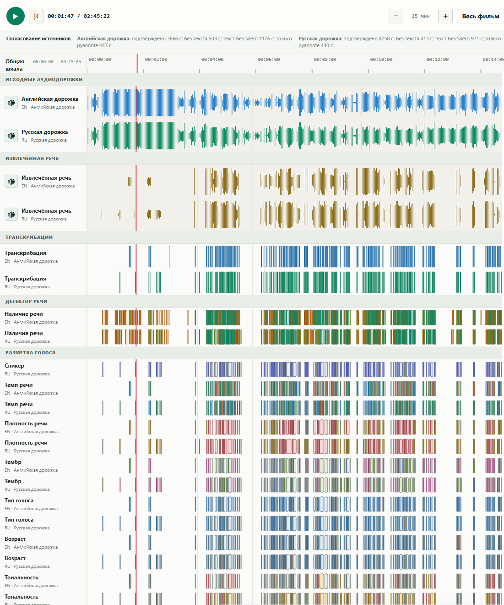
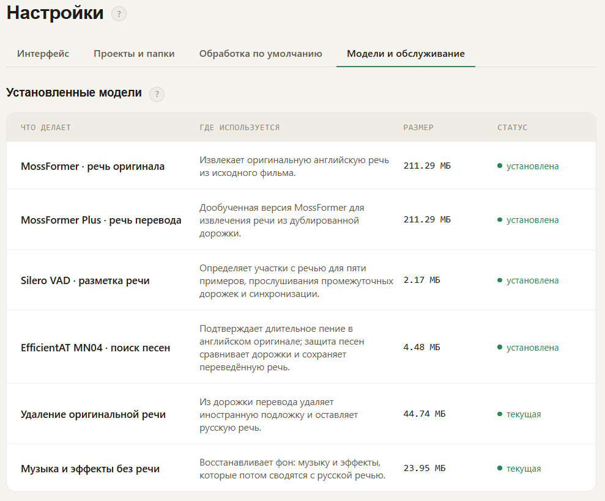
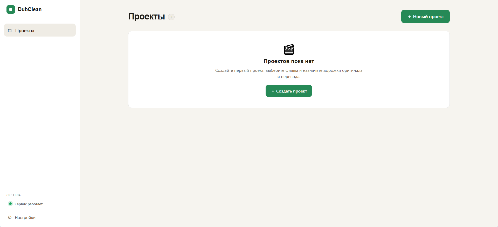
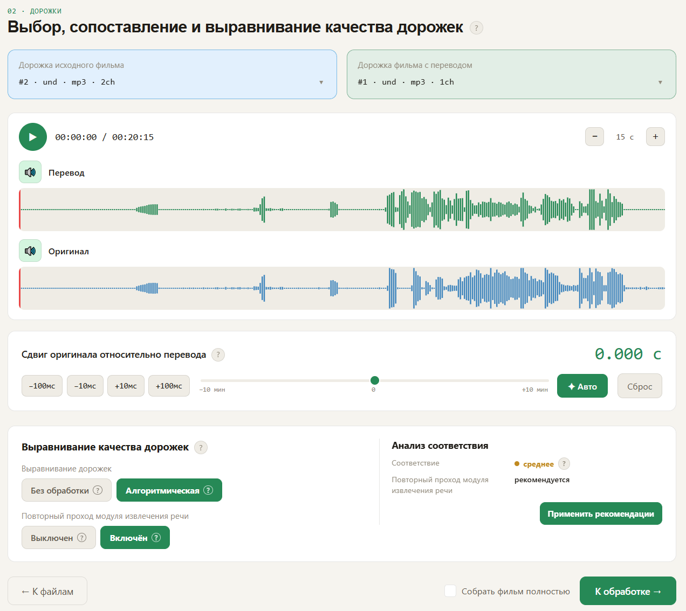
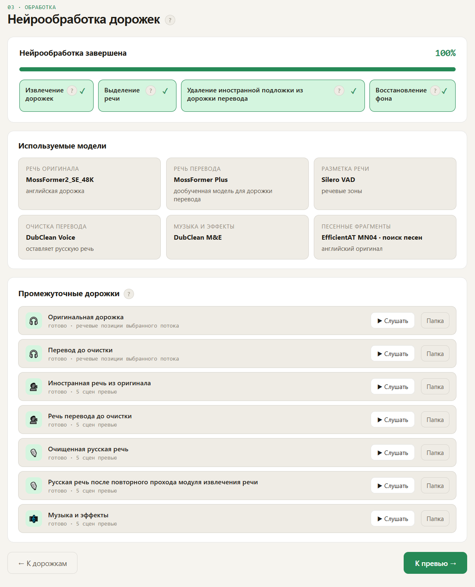
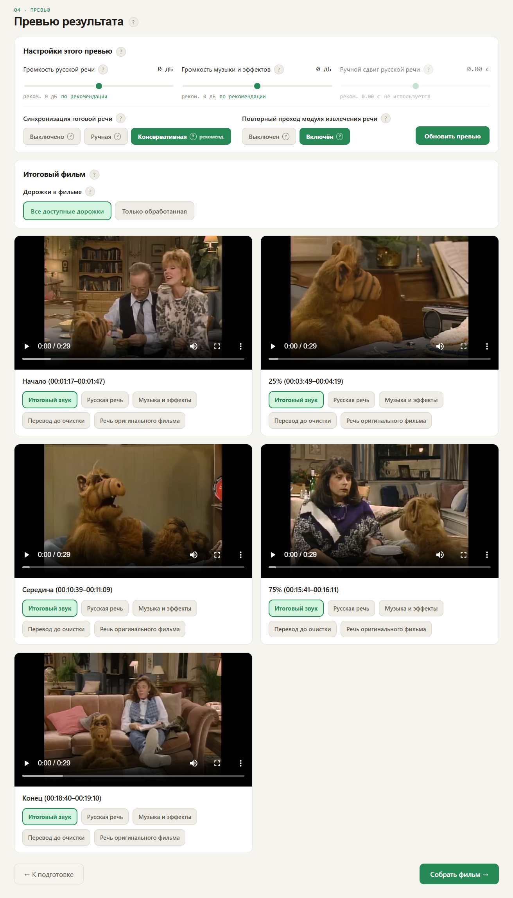
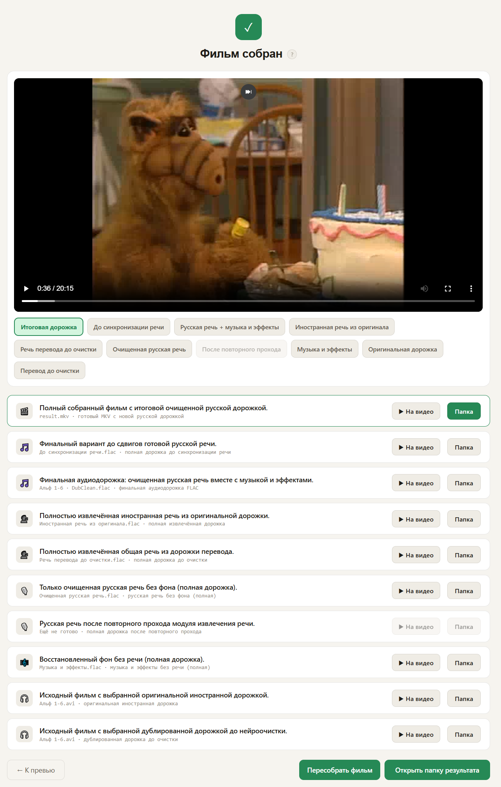

# Скриншоты DubClean

[К статье](README.md) · [К проекту](../../README.md)

Разметчик использовался при подготовке данных. Остальные снимки показывают
пользовательский интерфейс сервиса от выбора дорожек до готового результата.
Это изображения интерфейса, не воспроизводимые видео. Примеры со звуком
находятся в [отдельной папке](https://drive.google.com/drive/folders/1ri__0lu4-taE9kT4xnoywwnoFfSZ8jy6).

## Разметчик фильмов

Исходные дорожки, извлечённая речь, транскрибация, детекторы речи и голосовые признаки на общей временной шкале.

## Установленные модели

Состав рабочего конвейера в настройках сервиса. На снимке показана рабочая установка;
размеры её чекпойнтов отличаются от уменьшенных публичных экспортов для инференса.

## Список проектов

Стартовый экран перед созданием первого проекта.

## Выбор и сопоставление дорожек

Назначение оригинала и перевода, прослушивание, сдвиг по времени и параметры обработки.

## Нейрообработка

Этапы обработки, используемые модели и доступные для прослушивания промежуточные слои.

## Превью

Пять сцен из разных частей исходника для проверки результата до полной сборки.

## Готовый результат

Переключение звуковых слоёв и доступ к собранному видео и отдельным дорожкам.

